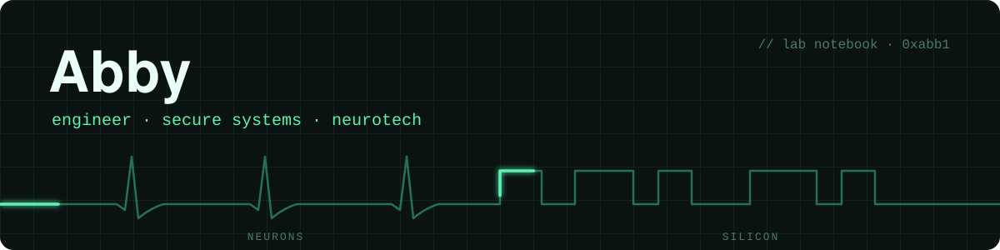

<!-- Profile README for github.com/0xabb1 · draft v3 -->

  

<h3 align="center">Engineer by training. Scientist by temperament.</h3>

  I build systems, find out how they fail, and rebuild them so they don't, 
  on the way to connecting computers with the human brain.

  <a href="https://www.linkedin.com/in/abhishek-singh-8b7536145">LinkedIn</a>
  <!-- · <a href="mailto:you@example.com">Email</a> -->

---

## 👋 About

- 🛠️ B.Eng in **Computer Engineering**, Thapar University
- Off the keyboard: 🏊 swimming · 🥊 boxing · 🏇 equestrian
- 🔐 Cybersecurity interests me because it's everywhere, in everything we build

## 🧰 Equipment

<table>
  <tr>
    <td><b>Languages</b></td>
    <td>
      
      
      
      
      
    </td>
  </tr>
  <tr>
    <td><b>Security</b></td>
    <td>
      
      
      
      
      
      &nbsp;+ Nmap
    </td>
  </tr>
  <tr>
    <td><b>Full stack</b></td>
    <td>
      
      
      
      
      
      
      
      
      
      
      
      
      
    </td>
  </tr>
  <tr>
    <td><b>Cloud &amp; DevOps</b></td>
    <td>
      
      
      
      
      
      
      
      
    </td>
  </tr>
  <tr>
    <td><b>Engineering</b></td>
    <td>
      
      
      
      
      
      
      
      
      
    </td>
  </tr>
</table>

---

  Immanuel Kant argued that we can know the principles of Euclidean geometry <i>a priori</i> because they arise from our intuition of space. For some two thousand years, Euclid’s geometry had served as a model of reasoning from self-evident truths. Yet one of its starting points, the parallel postulate, puzzled mathematicians for centuries. By asking what would follow if they changed that assumption, they discovered other consistent geometries.

  Question the axioms.

  
  &nbsp;
  

  ⚠️ Lab safety notice: all experiments run in isolated environments. Mostly. 
  <code>0xabb1</code> = 43953 in decimal. Yes, it's valid hex. Yes, I checked.

